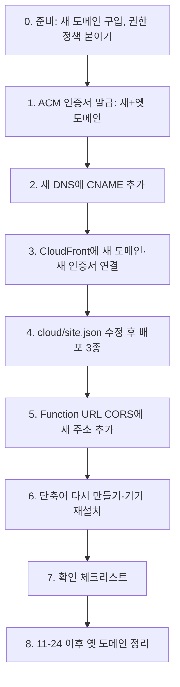

# 도메인 이관 로드맵 (7-B: 새 도메인으로 옮기기)

작성: 2026-10-09 · 대상: 서랍(bookmark-shelf) · 현재 도메인 `<SITE_DOMAIN>`

> 이 문서는 "새 도메인으로 옮길 때 무엇을, 어떤 순서로, 왜 해야 하는지"를 처음 보는 사람도 따라 할 수 있게 적은 작업 지시서다.
> 2026-10-09에 도메인을 설정 파일 한 곳(`cloud/site.json`)으로 모아 두었다. 그래서 코드 수정 없이 **설정 한 줄 + 배포 명령 몇 개 + 콘솔 작업**으로 옮길 수 있다.

---

## 0. 한눈에 보기

| 항목 | 값 |
|---|---|
| 현재 도메인 | `<SITE_DOMAIN>` (등록 업체: <DNS_REGISTRAR>, DNS도 <DNS_REGISTRAR>) |
| 도메인 등록 만료 | **2026-11-24** (WHOIS `Registry Expiry Date: 2026-11-24T23:59:59Z`) |
| 만료되면 | `https://<SITE_DOMAIN>` 접속 불가 → 웹 화면, 사진, 단축어의 "서랍에서 보기", worker의 사진 내려받기가 멈춘다 |
| 만료돼도 계속 되는 것 | 단축어의 저장(링크·사진 POST), API 자체(Lambda Function URL), 공유 링크(`/s/…`: 2026-10-10부터 CloudFront 기본 주소 `<CLOUDFRONT_DEFAULT_DOMAIN>`, 그 전에 보낸 것은 Function URL). 모두 도메인과 무관한 AWS 주소다 |
| 바꾸지 않아도 되는 것 | S3 버킷 이름(`<SITE_DOMAIN>`), CloudFront 배포 자체, Lambda 함수, ECR, SSM 파라미터(AI 로그인 정보), EventBridge |
| 권장 일정 | 11월 둘째 주까지 새 도메인으로 전환을 끝내고, 11-24 전까지 옛 도메인은 새 도메인으로 넘겨 주는(301) 상태로 둔다 |

### 전체 흐름



---

## 1. 2026-10-09에 미리 바꿔 둔 것 (하드코딩 제거)

### 1-1. 새 구조: 도메인은 `cloud/site.json` 한 곳

```json
{
  "site_domain": "<SITE_DOMAIN>",
  "bucket": "<SITE_DOMAIN>",
  "aws_profile": "<AWS_PROFILE>",
  "region": "<AWS_REGION>",
  "cloudfront_distribution": "<CLOUDFRONT_DISTRIBUTION_ID>",
  "api_function": "<API_LAMBDA_NAME>",
  "worker_function": "<WORKER_LAMBDA_NAME>",
  "gate_function": "<GATE_FUNCTION_NAME>"
}
```

- `site_domain`: 사람이 접속하는 주소. **이관 때 바꾸는 값은 이것 하나다.**
- `bucket`: S3 버킷 이름. 도메인과 이름이 같을 뿐 별개다. **바꾸지 않는다.**
- 나머지는 AWS 리소스 이름. 이관과 무관하다.
- 스크립트들은 `cloud/site_config.py`로 이 파일을 읽는다.
- 테스트 `tests/test_site_config.py`가 "문서·테스트·운영 데이터 밖의 코드에 도메인이 다시 박히면" 실패한다. 실수로 다시 하드코딩하는 것을 막는다.

### 1-2. 바꾼 곳 목록

| 파일 | 예전 | 지금 | 이관 때 할 일 |
|---|---|---|---|
| `cloud/api.py` `photo_url()` | `https://{버킷이름}/photos/…` (버킷 이름을 도메인으로 사용) | Lambda 환경변수 `SITE_URL` 기준. 없으면 예전과 같음 | `python3 cloud/deploy.py`가 `site.json` 값으로 `SITE_URL`을 맞춘다 |
| `cloud/api.py` `/api/memos/photo` | 절대 주소 `url`만 돌려줌 | `url` + 상대 주소 `path`(`/photos/…`) | 없음 |
| `static/index.html` "내 공간" 링크 | `https://<SITE_DOMAIN>/` | `/` (지금 열린 사이트) | 없음 |
| `static/index.html` 연결 안내 문구 | 도메인 글자 고정 | 지금 주소(`location.host`)를 표시 | 없음 |
| `static/index.html` "내 공간" 클릭 | 도메인이 같을 때만 앱 안에서 이동 | 항상 앱 안에서 이동 | 없음 |
| `static/index.html` 메모 사진 | `https://…` 사진만 표시, 새 사진도 절대 주소로 넣음 | 상대 주소 `/photos/<32자>.jpg`도 표시, 새 사진은 상대 주소로 넣음 | 없음 |
| 운영 데이터: 메모 본문 사진 3개 | `https://<SITE_DOMAIN>/photos/…` | `/photos/…` (`cloud/relink_memo_photos.py --apply`, 이전 S3 버전 `O0h05eZI35jKFMHByBlc6FCGRCCXfIGF`) | 없음. 이관 직전에 한 번 더 미리보기로 0개인지 확인 |
| `cloud/site-gate.js` `HOST` | 도메인 고정 | 자리표시 `__SITE_DOMAIN__` | `python3 cloud/deploy_gate.py`가 `site.json` 값으로 채워 발행 |
| `cloud/deploy_gate.py` | 함수 이름·배포 ID·도메인 고정 | `site.json`에서 읽음 | 위와 같음 |
| `make_shortcut.py` `SITE` | 도메인 고정 | `site.json`에서 읽음 | 단축어를 다시 만들어 서명·업로드·재설치 |
| `cloud/deploy.py` | 함수 이름·프로필 고정 | `site.json`에서 읽음 + `SITE_URL` 동기화 | 실행 |
| `cloud/deploy_worker.py` | 함수 이름·프로필 고정 | `site.json`에서 읽음 | 없음(worker 코드에는 도메인이 없음) |
| `cloud/backfill_threads.py` (및 이를 가져다 쓰는 `backfill_*`, `move_folders.py`) | 버킷 이름 고정 | `site.json`에서 읽음 | 없음 |
| `cloud/verify.py` | 도메인·버킷 고정 | `site.json`에서 읽음 | 없음 |

### 1-3. 지금도 도메인이 들어 있는 곳 (2026-10-09 기준 전체 목록)

**저장소 파일**

| 파일 | 내용 | 이관 때 |
|---|---|---|
| `cloud/site.json` | 유일한 설정값 | `site_domain`을 새 도메인으로 |
| `cloud/INFRA.md` | 운영 기록(9곳) | 이관 결과를 새 절로 추가하고 "현재" 값을 고친다. 과거 기록은 그대로 둔다 |
| `REQUESTS.md` | 과거 요청 기록(7곳) | 고치지 않는다(역사 기록) |
| `docs/DOMAIN_MIGRATION.md` | 이 문서 | 완료 표시 |
| `shortcuts/Save-to-Shelf.shortcut` (v12, 서명된 바이너리) | "서랍에서 보기"가 여는 주소 | `make_shortcut.py`로 다시 만든다 |

**저장소 밖 (AWS·DNS·기기)**

| 위치 | 도메인이 쓰이는 방식 | 이관 때 |
|---|---|---|
| CloudFront 배포 `<CLOUDFRONT_DISTRIBUTION_ID>` 대체 도메인(CNAME) | `<SITE_DOMAIN>` | 새 도메인 추가(전환기에는 둘 다) |
| ACM 인증서(us-east-1) `39c1879e-…` | `<SITE_DOMAIN>` 하나만 증명 | 새 도메인(+옛 도메인)을 담은 새 인증서로 교체 |
| CloudFront Function `<GATE_FUNCTION_NAME>` (배포된 코드) | 이 도메인이 아니면 301로 넘김 | `deploy_gate.py`로 다시 발행 |
| api Lambda 환경변수 `SITE_URL` | 사진 공개 주소 | `deploy.py`로 맞춤 |
| api Lambda Function URL CORS `AllowOrigins` | 웹 화면 주소를 허용 목록에 둠 | 새 주소 추가(아래 5단계) |
| <DNS_REGISTRAR> DNS | `<IAM_USER>` CNAME → CloudFront, ACM 검증용 CNAME | 옛 도메인은 만료까지 유지, 새 도메인은 새 DNS에 같은 구성 |
| 아이폰·맥에 설치된 단축어 | v12의 "서랍에서 보기" 주소 | 새 파일로 다시 설치 |
| 브라우저 쿠키 `shelf_key`·localStorage `shelf-key` | 도메인별로 따로 저장됨 | 새 도메인에서 접속 키를 한 번 입력 |
| 아이폰 홈 화면 아이콘·즐겨찾기 | 옛 주소 | 새 주소로 다시 추가 |

**도메인이 없어서 이관과 무관한 곳**

- `static/config.js`(S3): API 주소(Function URL)만 들어 있다.
- worker Lambda: API 주소(Function URL)로 일감을 받는다. 사진은 API가 알려 주는 주소(`SITE_URL`)로 내려받는다 → `SITE_URL`만 맞으면 된다.
- 공유 링크 `/s/<토큰>`: 2026-10-10부터 CloudFront 기본 주소(`config.js`의 `SHELF_SHARE_BASE`, `cloud/deploy_share_route.py`)로 만들어진다. 배포를 지우지 않는 한 도메인과 무관하다. 그 전에 보낸 Function URL 링크도 계속 열린다.
- S3 버킷 이름·버킷 정책·OAC: 도메인이 아니라 CloudFront 배포 ARN을 조건으로 쓴다.

### 1-4. S3 주소는 왜 안 바꿔도 되나

- 버킷 이름 `<SITE_DOMAIN>`는 "이름"일 뿐 도메인 소유와 관계없다. 도메인이 만료돼도, 남이 그 도메인을 사도 버킷은 그대로 내 것이다.
- CloudFront가 S3에서 파일을 가져오는 주소(`<SITE_DOMAIN>.s3-website.<AWS_REGION>.amazonaws.com`, `<SITE_DOMAIN>.s3.<AWS_REGION>.amazonaws.com`)는 `amazonaws.com` 아래의 AWS 주소다.
- 버킷 이름은 바꿀 수 없다. 새 이름 버킷으로 옮기려면 데이터 복사 + Lambda `DATA_BUCKET` + IAM 정책 2개 + 버킷 정책 + OAC + CloudFront 오리진 2개를 모두 바꿔야 한다. 얻는 것이 없다.
- 유일한 문제는 "버킷 이름을 사이트 주소로 쓰던 코드"였고, 1-2에서 `SITE_URL`로 분리했다.

---

## 2. 필요한 권한

### 2-1. 지금 `<IAM_USER>` 사용자로 되는 것 / 안 되는 것

| 작업 | 지금 | 필요한 권한 |
|---|---|---|
| api 코드 배포·환경변수(`SITE_URL`) 변경 | 됨 | (`<IAM_POLICY_NAME>`에 있음) |
| S3에 `index.html`·단축어 올리기 | 됨 | (있음) |
| CloudFront 배포 조회·수정·무효화 | 됨 | (있음) |
| **ACM 인증서 발급·조회·삭제** | **안 됨** | `acm:RequestCertificate`, `acm:DescribeCertificate`, `acm:ListCertificates`, `acm:DeleteCertificate` … |
| **CloudFront Function(사이트 잠금) 발행** | **안 됨** | `cloudfront:UpdateFunction`, `PublishFunction`, `TestFunction`, `DescribeFunction` … |
| **Function URL CORS 조회·수정** | **안 됨** | `lambda:GetFunctionUrlConfig`, `lambda:UpdateFunctionUrlConfig` |
| 비용 조회(Cost Explorer) | 안 됨 | `ce:GetCostAndUsage` … |
| Lambda 호출 수·실행 시간 지표 | 안 됨 | `cloudwatch:GetMetricData`, `GetMetricStatistics` |
| Lambda 로그 읽기 | 안 됨 | `logs:FilterLogEvents` … |
| ECR 옛 이미지 삭제·수명 주기 정책 | 안 됨 | `ecr:BatchDeleteImage`, `ecr:PutLifecyclePolicy` … |
| 내 권한 정책 읽기 | 안 됨 | `iam:GetPolicyVersion` … (읽기만) |
| DNS 레코드 추가 | AWS 밖(<DNS_REGISTRAR>·새 DNS 업체 화면) | — |

### 2-2. 영구로 붙일 정책 하나: `bookmark-shelf-ops`

기존 `<IAM_POLICY_NAME>`은 그대로 두고, 고객 관리형 정책을 **하나 더** 만들어 `<IAM_USER>` 사용자에 붙인다. (기존 정책에 합치면 관리형 정책 크기 한도 6,144자에 가까워진다.)

> **2026-10-09 변경(사용자 지시)**: 지금은 **비용 조회 + ECR 이미지 삭제** 권한만 붙인다. `data/iam/bookmark-shelf-ops.json`은 이 두 가지만 담은 작은 정책(공백 제외 435자)이다 — `ce:GetCostAndUsage`·`ce:GetCostForecast`, `cloudwatch:GetMetricStatistics`·`GetMetricData`·`ListMetrics`, 이 저장소 한정 `ecr:BatchDeleteImage`·`Get/PutLifecyclePolicy`.
> 아래의 큰 JSON(인증서·사이트 잠금 함수·Function URL·로그 읽기 포함)은 **이관할 때(0단계)** 같은 정책을 새 버전으로 바꿔 붙일 때 쓴다.
> "너무 길다"는 오류: 사용자 **인라인** 정책은 사용자 한 명당 모든 인라인 정책을 합쳐 2,048자까지다. 2-3처럼 **관리형 정책(정책 생성)** 으로 만들면 한도가 6,144자이고, 기존 인라인 정책 3개를 지우면 여유도 생긴다.

- 이관 때 쓸 전체 버전(아래)은 계정 ID를 `<account-id>`로 가린 것이다.

```json
{
  "Version": "2012-10-17",
  "Statement": [
    { "Sid": "CostRead", "Effect": "Allow",
      "Action": ["ce:GetCostAndUsage", "ce:GetCostForecast", "ce:GetDimensionValues", "ce:GetTags"],
      "Resource": "*" },
    { "Sid": "MetricsRead", "Effect": "Allow",
      "Action": ["cloudwatch:GetMetricData", "cloudwatch:GetMetricStatistics", "cloudwatch:ListMetrics"],
      "Resource": "*" },
    { "Sid": "LambdaLogsRead", "Effect": "Allow",
      "Action": ["logs:DescribeLogStreams", "logs:GetLogEvents", "logs:FilterLogEvents", "logs:StartQuery"],
      "Resource": [
        "arn:aws:logs:<AWS_REGION>:<account-id>:log-group:/aws/lambda/<API_LAMBDA_NAME>:*",
        "arn:aws:logs:<AWS_REGION>:<account-id>:log-group:/aws/lambda/<WORKER_LAMBDA_NAME>:*" ] },
    { "Sid": "LogsQueryResults", "Effect": "Allow",
      "Action": ["logs:GetQueryResults", "logs:StopQuery"], "Resource": "*" },
    { "Sid": "EcrCleanup", "Effect": "Allow",
      "Action": ["ecr:BatchDeleteImage", "ecr:GetLifecyclePolicy", "ecr:PutLifecyclePolicy",
                 "ecr:StartLifecyclePolicyPreview", "ecr:GetLifecyclePolicyPreview"],
      "Resource": "arn:aws:ecr:<AWS_REGION>:<account-id>:repository/<WORKER_LAMBDA_NAME>" },
    { "Sid": "ApiFunctionUrl", "Effect": "Allow",
      "Action": ["lambda:GetFunctionUrlConfig", "lambda:UpdateFunctionUrlConfig"],
      "Resource": "arn:aws:lambda:<AWS_REGION>:<account-id>:function:<API_LAMBDA_NAME>" },
    { "Sid": "SiteGateFunction", "Effect": "Allow",
      "Action": ["cloudfront:CreateFunction", "cloudfront:UpdateFunction", "cloudfront:PublishFunction",
                 "cloudfront:DescribeFunction", "cloudfront:GetFunction", "cloudfront:TestFunction"],
      "Resource": "arn:aws:cloudfront::<account-id>:function/<GATE_FUNCTION_NAME>" },
    { "Sid": "CertificateRequest", "Effect": "Allow",
      "Action": ["acm:RequestCertificate", "acm:ListCertificates"], "Resource": "*" },
    { "Sid": "CertificateManage", "Effect": "Allow",
      "Action": ["acm:DescribeCertificate", "acm:GetCertificate", "acm:AddTagsToCertificate",
                 "acm:ListTagsForCertificate", "acm:DeleteCertificate"],
      "Resource": "arn:aws:acm:us-east-1:<account-id>:certificate/*" },
    { "Sid": "SelfPolicyRead", "Effect": "Allow",
      "Action": ["iam:GetUser", "iam:ListAttachedUserPolicies", "iam:ListUserPolicies", "iam:GetUserPolicy"],
      "Resource": "arn:aws:iam::<account-id>:user/<IAM_USER>" },
    { "Sid": "ProjectPolicyRead", "Effect": "Allow",
      "Action": ["iam:GetPolicy", "iam:GetPolicyVersion", "iam:ListPolicyVersions"],
      "Resource": "arn:aws:iam::<account-id>:policy/bookmark-shelf-*" }
  ]
}
```

**각 묶음이 하는 일**

| Sid | 왜 필요한가 | 위험도 |
|---|---|---|
| CostRead | 월 청구액을 서비스별로 조회 | 읽기만. 계정 전체 비용이 보인다(리소스 범위 지정 불가) |
| MetricsRead | Lambda 호출 수·실행 시간 → 실제 월 비용 계산 | 읽기만(리소스 범위 지정 불가) |
| LambdaLogsRead / LogsQueryResults | 오류 원인 확인 | 읽기만. 이 프로젝트 로그 그룹 2개로 한정 |
| EcrCleanup | 옛 worker 이미지 15개 삭제, "최근 3개 보관" 규칙 | 삭제 가능. 이 저장소 하나로 한정. 지금 쓰는 이미지를 지우면 worker가 멈출 수 있으니 삭제 전 확인 |
| ApiFunctionUrl | CORS 허용 주소에 새 도메인 추가 | 수정 가능. api 함수 하나로 한정. `AuthType`을 바꿀 수도 있으니 CORS만 고칠 것 |
| SiteGateFunction | 사이트 잠금 함수의 도메인·키 해시 갱신 | 수정 가능. 함수 하나로 한정. 예전에는 "키 바꿀 때만 잠깐" 붙이던 권한(사용자가 영구로 결정, 2026-10-09) |
| CertificateRequest | 새 인증서 발급 요청, 목록 | 발급 요청은 리소스 범위 지정이 안 된다(AWS 설계). 공개 인증서는 무료 |
| CertificateManage | 인증서 상태·검증 레코드 조회, 옛 인증서 삭제 | 삭제 가능. us-east-1 인증서로 한정 |
| SelfPolicyRead / ProjectPolicyRead | 내가 가진 권한을 직접 확인 | 읽기만. 권한을 늘리는 동작(`Attach…`, `Put…`, `CreatePolicyVersion`)은 없다 |

**넣지 않은 것**: `iam:*` 쓰기, `route53:*`(새 DNS를 Route 53으로 정하면 그때 추가), `s3:PutBucketPolicy`(이관에 필요 없음), `cloudfront:CreateDistribution`.

### 2-3. 콘솔에서 붙이는 방법 (계정 소유자로 로그인)

1. AWS 콘솔 → **IAM** → 왼쪽 **정책(Policies)** → **정책 생성(Create policy)**.
2. **JSON** 탭을 고르고 `data/iam/bookmark-shelf-ops.json` 내용을 그대로 붙여 넣는다 → **다음**.
3. 정책 이름 `bookmark-shelf-ops` → **정책 생성**.
4. 왼쪽 **사용자(Users)** → `<IAM_USER>` → **권한 추가(Add permissions)** → **정책 직접 연결** → `bookmark-shelf-ops` 체크 → **권한 추가**.
5. 붙인 뒤 확인(터미널):
   ```sh
   aws iam list-attached-user-policies --user-name <IAM_USER> --profile <AWS_PROFILE>
   aws ce get-cost-and-usage --profile <AWS_PROFILE> --region us-east-1 \
     --time-period Start=2026-10-01,End=2026-10-09 --granularity MONTHLY --metrics UnblendedCost
   ```
6. 같이 정리하면 좋은 것(콘솔에서만 가능): `<IAM_USER>` 사용자의 인라인 정책 `<TEMP_IAM_POLICY_NAME>`, `cloudwatch-logs-retention`, `invoke-worker`는 이미 다른 정책에 포함됐거나 다 쓴 권한이다 → 삭제.

> Cost Explorer는 계정에서 한 번 켜져 있어야 한다(Billing 콘솔 → Cost Explorer 열기). 켠 직후에는 데이터가 채워질 때까지 최대 24시간 걸린다.

---

## 3. 단계별 작업

아래에서 `NEW`는 새 도메인(예: `shelf.example.com`), `OLD`는 `<SITE_DOMAIN>`다.

### 0단계. 준비 (D-14 이전)

- [ ] 새 도메인을 구입하거나, 이미 가진 도메인의 하위 주소를 정한다. `NEW`를 정한다.
- [ ] 새 도메인의 DNS를 어디서 관리할지 정한다(<DNS_REGISTRAR>, Cloudflare, Route 53 등). Cloudflare를 쓰면 **프록시(주황 구름)를 끄고 "DNS only"**로 둔다(CloudFront 앞에 또 프록시가 있으면 인증서·캐시가 꼬인다).
- [ ] 2-3대로 `bookmark-shelf-ops` 권한을 붙인다.
- [ ] 접속 키(`data/token`)를 확인해 둔다. 새 도메인에서는 모든 기기에서 한 번씩 다시 입력해야 한다.
- [ ] 옛 도메인을 11-24 이후에도 잠깐 쓰고 싶으면 <DNS_REGISTRAR>에서 1년 갱신 비용을 확인한다(.store는 갱신가가 비싼 편). 갱신하지 않을 거면 아래 순서대로 11월 둘째 주까지 끝낸다.

### 1단계. 인증서 발급 (us-east-1, 무료)

CloudFront는 **us-east-1(버지니아) 리전의 ACM 인증서만** 쓴다. 한 배포에는 인증서를 하나만 붙일 수 있으므로, 전환 기간에 두 주소를 다 받으려면 **두 도메인을 함께 담은 인증서**가 필요하다.

```sh
aws acm request-certificate --region us-east-1 --profile <AWS_PROFILE> \
  --domain-name NEW --subject-alternative-names OLD \
  --validation-method DNS
# 출력된 CertificateArn을 적어 둔다
aws acm describe-certificate --region us-east-1 --profile <AWS_PROFILE> --certificate-arn <새 ARN> \
  --query 'Certificate.DomainValidationOptions[].ResourceRecord'
```

- 출력되는 검증용 CNAME 2개(이름 `_xxxx.NEW.` → 값 `_yyyy.acm-validations.aws.`)를 각 DNS에 추가한다.
  - `NEW` 쪽 레코드 → 새 DNS 업체
  - `OLD` 쪽 레코드 → <DNS_REGISTRAR>. **이미 같은 이름의 레코드가 있으면 그대로 둔다**(같은 계정·같은 도메인은 같은 검증 값이 나오는 경우가 많다).
- `Status`가 `ISSUED`가 될 때까지 기다린다(보통 5~30분).
  ```sh
  aws acm describe-certificate --region us-east-1 --profile <AWS_PROFILE> --certificate-arn <새 ARN> --query Certificate.Status
  ```
- ⚠️ 이 인증서는 OLD가 만료된 뒤 자동 갱신(약 13개월 뒤)에 실패한다. 8단계에서 NEW만 담은 인증서로 다시 바꾼다.

### 2단계. 새 DNS에 사이트 주소 연결

- 새 DNS에 `NEW` → `<CLOUDFRONT_DEFAULT_DOMAIN>` **CNAME**을 추가한다.
  - 루트 도메인(예: `example.com` 자체)은 CNAME을 못 쓰는 DNS가 많다. 그때는 `shelf.example.com` 같은 하위 주소를 쓰거나, Route 53 별칭(Alias)/Cloudflare CNAME 평탄화를 쓴다.
- TTL은 300초(5분) 정도로 짧게 둔다.
- 이 단계까지는 CloudFront가 NEW를 모르므로, NEW로 열면 오류(403)가 나는 게 정상이다.

### 3단계. CloudFront에 새 도메인·새 인증서 연결

콘솔이 가장 안전하다: **CloudFront → 배포 `<CLOUDFRONT_DISTRIBUTION_ID>` → 일반(General) → 편집(Edit)**

1. **대체 도메인 이름(CNAME)**: `OLD`는 그대로 두고 `NEW`를 추가한다.
2. **사용자 지정 SSL 인증서**: 1단계에서 받은 새 인증서(NEW+OLD)를 고른다.
3. 저장 → 상태가 "배포 중(Deploying)"에서 끝날 때까지 기다린다(5~15분).

이때 사이트 잠금 함수는 아직 OLD만 "진짜 주소"로 알고 있어서, NEW로 들어오면 OLD로 301 이동시킨다. 정상이다(4단계에서 바꾼다).

### 4단계. 설정 한 줄 바꾸고 배포 3종

```sh
cd ~/Documents/app/bookmark-shelf
# 1) cloud/site.json 의 "site_domain" 을 NEW 로 바꾼다 ("bucket" 은 그대로!)
python3 -m unittest discover -s tests          # 2) 테스트
python3 cloud/deploy.py                        # 3) api: SITE_URL=https://NEW 로 맞춤 → 사진 주소가 NEW 로 나간다
python3 cloud/deploy_gate.py --test-only       # 4) 사이트 잠금: 가짜 키로 시험만
python3 cloud/deploy_gate.py                   # 5) 시험 통과하면 발행. 이제 OLD로 들어오면 NEW로 301
```

- `index.html`은 도메인이 없으므로 다시 올릴 필요가 없다.
- worker는 다시 배포할 필요가 없다. 사진 주소를 api가 알려 주기 때문이다.
- 순서가 중요하다: **3단계(CloudFront가 NEW를 받음)가 끝난 뒤** 3)~5)를 한다. 먼저 하면 사진 주소가 아직 열리지 않는 NEW를 가리켜 사진이 깨진다.

### 5단계. Function URL CORS에 새 주소 추가

웹 화면(NEW)이 API(Function URL)를 부르려면 API가 "NEW에서 온 요청을 허용"해야 한다.

```sh
aws lambda get-function-url-config --function-name <API_LAMBDA_NAME> --profile <AWS_PROFILE> --region <AWS_REGION> --query Cors
```

- 출력의 `AllowOrigins`에 `https://NEW`를 **추가**한다(OLD는 8단계까지 남김). 다른 항목(`AllowHeaders`, `AllowMethods`, `MaxAge` 등)은 그대로 복사한다.
  ```sh
  aws lambda update-function-url-config --function-name <API_LAMBDA_NAME> --profile <AWS_PROFILE> --region <AWS_REGION> \
    --cors '{"AllowOrigins":["https://NEW","https://OLD", ...기존 값...],"AllowMethods":[...기존...],"AllowHeaders":[...기존...],"MaxAge":...}'
  ```
- 만약 `AllowOrigins`가 `["*"]`이면 이 단계는 필요 없다.
- 이 값을 지금 권한으로는 읽을 수 없어 2026-10-09 기준 실제 값은 미확인이다(문서상 `http://<SITE_DOMAIN>`, S3 웹 엔드포인트, `localhost:8787`).

### 6단계. 단축어 다시 만들기 · 기기 정리

```sh
python3 make_shortcut.py          # v12: "서랍에서 보기"가 https://NEW/#item/… 를 연다 (맥에서만, shortcuts sign 필요)
python3 make_shortcut.py --v11    # 롤백용 v11도 같이 갱신하려면
aws s3api put-object --bucket <SITE_DOMAIN> --key shortcuts/Save-to-Shelf.shortcut \
  --body shortcuts/Save-to-Shelf.shortcut --profile <AWS_PROFILE> --region <AWS_REGION>
```

기기마다:
- [ ] 아이폰·맥에서 `https://NEW` 열기 → 접속 키 입력(쿠키·저장 키가 도메인별이라 한 번은 필요).
- [ ] 단축어 앱에서 옛 "서랍에 저장" 삭제 → `https://NEW/shortcuts/Save-to-Shelf.shortcut`로 새로 설치 → 접속 키 입력.
- [ ] 아이폰 홈 화면 아이콘·Safari 즐겨찾기를 NEW로 다시 추가.

### 7단계. 확인 체크리스트

| 확인 | 방법 | 기대 결과 |
|---|---|---|
| 새 주소 HTTPS | `curl -sI https://NEW/` | `200`, 인증서 오류 없음 |
| 옛 주소 넘김 | `curl -sI https://OLD/` | `301`, `location: https://NEW/` |
| 잠금 화면 | 키 없는 새 창으로 `https://NEW` | 접속 키 입력 화면 |
| 사진 주소 | 키를 넣고 사진 카드 열기 / `GET /api/items`의 사진 `url` | `https://NEW/photos/…`, 이미지 200 |
| 메모 사진 | 사진 있는 메모(예: "추가 기능") 열기 | 사진 3장 보임 |
| 저장 | 아이폰에서 링크 공유 → 새 단축어 | "서랍에 저장했어요" → "서랍에서 보기"가 NEW로 열림 |
| 사진 정리(worker) | 사진 하나 공유 후 1~2분 | 카드가 "사진 정리 대기"에서 제목·요약으로 바뀜(worker가 `https://NEW/photos/…`를 내려받음) |
| CORS | NEW에서 카드 수정·삭제 | 오류 없이 반영 |
| 공유 링크 | 예전에 보낸 `/s/…` 링크 | 그대로 열림(Function URL 주소라 무관) |
| 테스트 | `python3 -m unittest discover -s tests` | 전부 통과 |

### 8단계. 옛 도메인 정리 (11-24 직전·직후)

- [ ] (만료 전) 1단계와 같은 방법으로 **NEW만 담은 인증서**를 새로 발급 → CloudFront 인증서를 그것으로 교체.
- [ ] CloudFront 대체 도메인에서 OLD 삭제.
- [ ] Function URL CORS에서 OLD(`http://`·`https://` 모두) 삭제.
- [ ] 쓰지 않는 옛 인증서 2개(`39c1879e-…`, NEW+OLD 인증서) 삭제: `aws acm delete-certificate --region us-east-1 --certificate-arn …`
- [ ] <DNS_REGISTRAR>에서 OLD의 CNAME·검증 레코드는 만료와 함께 사라진다(따로 할 일 없음).
- [ ] `cloud/INFRA.md`에 "도메인 이관(날짜)" 절 추가, "현재 살아있는 리소스"의 도메인·인증서 값 갱신. 이 문서 상단에 완료 표시.

---

## 4. 되돌리기

| 상황 | 되돌리는 법 |
|---|---|
| 4단계 뒤 사진이 깨짐 | `cloud/site.json`을 OLD로 되돌리고 `python3 cloud/deploy.py` (SITE_URL 복귀) |
| 4단계 뒤 사이트가 계속 301만 돈다 | `site.json`을 OLD로 되돌리고 `python3 cloud/deploy_gate.py`. 급하면 CloudFront 콘솔 → 동작 → 기본값 → 함수 연결 viewer-request를 "연결 없음"(잠금이 풀리니 바로 다시 연결할 것) |
| 3단계 뒤 HTTPS 오류 | CloudFront 인증서를 옛 인증서(`39c1879e-…`)로 되돌리고 NEW를 대체 도메인에서 뺀다 |
| 메모 사진 주소 변경을 되돌리기 | S3 `data/cards.json` 이전 버전 `O0h05eZI35jKFMHByBlc6FCGRCCXfIGF` 복원(그 뒤 변경도 함께 사라지므로 주의) |
| 웹 화면 되돌리기 | S3 `index.html` 이전 버전 `quuSx3I6MkMw7WVY3elRqRvJZsnhKDcM` 복원 |

## 5. 주의점 모음

1. **순서**: CloudFront가 NEW를 받기 전에 `deploy.py`/`deploy_gate.py`를 돌리면 사진·사이트가 깨진다.
2. **인증서는 us-east-1**: 서울 리전에서 발급하면 CloudFront 목록에 안 나온다.
3. **인증서 하나에 두 도메인**: 전환기에는 NEW+OLD를 함께 담고, OLD가 끝나면 NEW만 담은 것으로 교체한다. 그대로 두면 1년 뒤 자동 갱신이 실패해 HTTPS가 끊긴다.
4. **버킷 이름은 그대로**: `site.json`의 `bucket`을 바꾸면 모든 저장·읽기가 실패한다.
5. **접속 키는 기기마다 다시**: 쿠키·저장 키는 도메인별이다. 키를 미리 확인해 둔다.
6. **사진 캐시**: `photos/*`는 1년 불변 캐시지만 주소(도메인)가 바뀌면 새로 받는다. 첫 화면이 잠깐 느릴 수 있다.
7. **Cloudflare를 쓰면 DNS only**: 프록시를 켜면 CloudFront와 이중 프록시가 된다.
8. **공개 미러**: `cloud/site.json`, 이 문서의 값은 `mirror-push.sh`가 `mirror-redact.txt` 목록으로 가린다. 새 도메인을 그 목록에 추가해야 공개 미러에 새 도메인이 나가지 않는다.
9. **옛 도메인 만료 후**: 남이 OLD를 살 수 있다. 그 전에 모든 기기·단축어가 NEW로 바뀌었는지 확인한다(옛 단축어의 "서랍에서 보기"가 남의 사이트를 열 수 있다).
